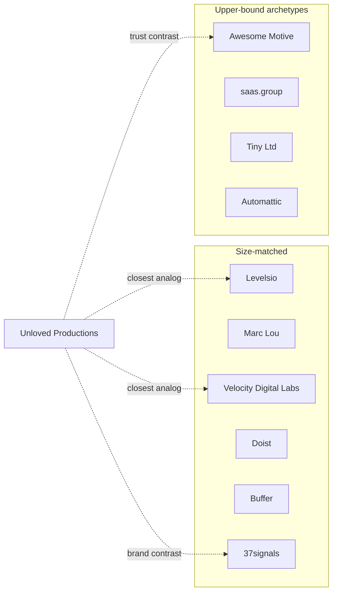

# Holding-company competitor landscape

**Subject:** Unloved Productions  
**Date:** 2026-08-21  
**Genre:** landscape + weakness map  
**Depth:** deep  
**Folder:** `research/holding-competitors/`

Every claim below binds to a file in `sources/`. Revenue figures from Levels, Marc Lou, Doist, and saas.group are self-reported or interview-era unless noted.

---

## Verdict

Unloved is not competing with BookBolt or DeleteMe at the holding layer. The real peer set is a handful of multi-product indie studios. Their shared weakness is not “they lack a fifth product.” It is the **second-product tax**: attention, quality, and GTM split, then a parent brand that either hides (Awesome Motive), collapses to a person (Levels / Marc Lou), or only works after a hit plus a rename (37signals).

Unloved’s portfolio looks like Levels without the audience and like Awesome Motive without the shared WordPress customer. That combination is the hole. The exploitable gap is a **named, paid, non-nagging operator brand** — which 37signals already occupies at a much higher altitude, and which AM is busy setting on fire.

---

## Peer map

### Size-matched / model-matched

| Peer | Products | Glue | Weakness |
|---|---|---|---|
| **Pieter Levels** | Nomad List, RemoteOK, PhotoAI, long tail | Personal brand + nomad audience | Portfolio is a trap without that audience. [19](sources/19_solopreneurship_levels.md) |
| **Marc Lou** | ShipFast, CodeFast, DataFast, TrustMRR + graveyard | Build-in-public to other builders | Famous product ≠ top earner; 39 listed products. [20](sources/20_solopreneurship_marc_lou.md) [21](sources/21_medium_marc_lou_graveyard.md) |
| **Velocity Digital Labs** | 8 active SaaS, 1 founder + 1 manager | Shared Next.js/Stripe stack | Founder admits 2–3 get attention; rest maintenance or should-sunset. [18](sources/18_vdl_portfolio.md) |
| **37signals** | Basecamp, HEY, Fizzy, ONCE | Idea-led studio; paid not ads | 2014: six products ≈ 18 surfaces, quality bar failed; renamed to Basecamp then back. [04](sources/04_jason_fried_bos.md) [01](sources/01_37signals_hello_again.md) |
| **Doist** | Todoist, Twist | Async/remote philosophy | Twist “too early”; founder would only go multi-product if growth stalls. [17](sources/17_linkedin_amir_twist.md) [16](sources/16_firstmrr_doist.md) |
| **Buffer** | Publish core; Reply acquired then killed | SMB social | Reply: 500 vs 70k customers, different department, slow fixes. [05](sources/05_buffer_sunset_reply.md) |

### Upper-bound archetypes (not peers)

| Archetype | Model | Why it is in the file | Weakness to steal from, not copy |
|---|---|---|---|
| **Awesome Motive** | 30+ WP brands, 300+ people, SEO network | Same-customer federation Unloved is *not* | Hidden parent, nags, opaque onboarding. [06](sources/06_syed_balkhi_am_manual.md) [07](sources/07_ellipsis_am_marketing.md) [10](sources/10_sej_wpforms.md) |
| **saas.group** | Buy $1–10M ARR SaaS, hold | Industrialized back office | Continuity risk as portfolio ages; no consumer brand. [14](sources/14_productled_saas_group.md) |
| **Tiny Ltd** | Public internet holdco, 21 companies, leave them alone | The “Berkshire of the internet” story Unloved might romanticize | Services-heavy mix, ~19% recurring, leverage, abdication. [12](sources/12_tiny_press.md) [13](sources/13_sbo_tiny_teardown.md) |
| **Automattic** | 4 cores + ~14 other apps | Extreme of portfolio sprawl | Clunky upgrade path; core still needs love. [22](sources/22_wp_minute_automattic.md) |

**Excluded:** BookBolt, DeleteMe, Google Translate, Acquire.com (wrong unit). 2026 brochure sites (Stakyo, Furiaa, UTLTY) — no independent corroboration.

---

## Hypothesis verdicts

| # | Hypothesis | Verdict |
|---|---|---|
| 1 | True peer set <12; specialists are not holding-level competitors | **Confirmed.** Six size-matched names, four archetypes. [F1](findings/F1_peer_set_is_small.md) |
| 2 | Peers fail on brand coherence / cross-sell | **Confirmed, split.** Unrelated stacks need a person. Same-ICP federations hide the parent and still convert. [F2](findings/F2_coherence_requires_shared_icp.md) |
| 3 | Peers under-invest in trust vs shipping | **Refuted as blanket.** 37signals over-invests. AM burns trust for installs. Ship-first studios: under-determined. [F3](findings/F3_trust_split.md) |
| 4 | Distribution without owned audience is common | **Confirmed, refined.** SEO can be durable (AM). Founder audience is the Levels/Marc Lou precondition. Unloved has neither at peer scale. [F4](findings/F4_distribution_precondition.md) |

Load-bearing finding, not in the original four: the **second-product tax** is the shared operational weakness. [F5](findings/F5_second_product_tax.md)

---

## Weakness clusters

### 1. Attention is sublinear

VDL: product two gets scraps; products three–four fight for 10–15% of headspace; eight products means two or three get real work. [18](sources/18_vdl_portfolio.md)

Fried: six products with mobile clients is eighteen things. [04](sources/04_jason_fried_bos.md)

Amir: Twist worked and still stole focus from a rocket. [17](sources/17_linkedin_amir_twist.md)

Unloved ships Flutter+Flask, privacy funnels, deal intel, Android translation, and paperbacks. That is more stack diversity than VDL’s admitted ceiling.

### 2. Cross-sell needs one customer

Buffer Reply users were in another department. [05](sources/05_buffer_sunset_reply.md)

AM cross-sells because every product is for a WordPress site owner — and still prefers SEO occupancy over honest “we own these plugins” ([07](sources/07_ellipsis_am_marketing.md)). Founder: outsiders think they are an auto shop. [06](sources/06_syed_balkhi_am_manual.md)

A KDP publisher does not become a Ghost Protocol buyer because the footer says Unloved. Treating the parent site as a conversion engine copies a mechanism that only works inside one ecosystem.

### 3. Trust is a strategy, or a tax

37signals: “selling products, not selling you.” [02](sources/02_37signals_we_dont_sell_you.md)

AM (2026): WPForms Lite wizard sent SEJ’s tester offsite without noticing; Privacy Compliance and extra plugins could not be unticked. [10](sources/10_sej_wpforms.md) Waaijer called it a backdoor; community said that word is doing too much work; the consent gap remains. 5M+ installs. [11](sources/11_webmastered_wpforms.md)

Customers already expect AM dashboards full of notices. [09](sources/09_wp_tavern_sandhills.md)

If Ghost Protocol is real, the parent cannot look like AM. If the parent looks like a product dump, it also cannot look like 37signals.

### 4. Distribution is the actual moat

Levels: code is not the moat. [19](sources/19_solopreneurship_levels.md)

Marc Lou: the revenue post is the channel. [20](sources/20_solopreneurship_marc_lou.md)

AM: a content network that occupies multiple SERP slots per money keyword. [07](sources/07_ellipsis_am_marketing.md)

Unloved’s holding homepage is a catalog. Catalogs do not compound.

---

## Positioning vs Unloved

Unloved’s own copy: holding company for underserved niches — KDP tools, privacy, abandoned-SaaS deals, a free KDP system, an offline translator, a Stoic imprint.

| Axis | Unloved today | Closest peer | Gap |
|---|---|---|---|
| Customer overlap | Near zero across products | AM: total overlap | Fatal for AM-style cross-sell |
| Team | One operator | VDL 2 / Levels 1 | Same tax, more stacks |
| Distribution | Site + product URLs | Levels audience / AM SEO / 37signals essays | Missing |
| Trust story | Implied by Ghost + Puente | 37signals explicit; AM negative | Unexploited |
| Holdco story | Named, manifesto | Tiny/saas.group acquire; 37signals make | Fine — do not scale the Tiny myth |

---

## Actionable gaps (holding layer only)

1. **Pick the parent sentence.** Not “five products.” Either “paid software, we don’t sell you” (steal from [02](sources/02_37signals_we_dont_sell_you.md) without copying Basecamp aesthetics) or “tools for people vendors skip” — then prove it with what you refuse (nags, offsite admin tokens, year-2 tricks).
2. **Stop expecting cross-sell.** Buffer already ran that experiment. Treat products as separate companies that share a back office. The holding site is an index and a trust page, not a funnel.
3. **Do not add a sixth product to look like a holdco.** VDL’s honest state is the warning. [18](sources/18_vdl_portfolio.md) Amir’s rule: multi-product when growth stalls, not while hunting it. [17](sources/17_linkedin_amir_twist.md)
4. **Build one distribution engine that is not a product.** WPBeginner, Nomad List, or Signal-style essays. Unloved has a manifesto and no engine. Without it, the Levels analog is the graveyard half of [21](sources/21_medium_marc_lou_graveyard.md).
5. **If any adjacency exists, it is KDP + books + Draft.** That is the only same-customer cluster in the portfolio. Privacy, deals, and translation are other companies.

---

## What not to copy

- AM playbook: countdown upsells, tutorial lists that always crown in-house tools, setup wizards that leave the user’s site. [08](sources/08_wp_minute_am_problem.md) [10](sources/10_sej_wpforms.md)
- Tiny as aspiration: public vehicle, services EBITDA, 27× operating-cash-flow debt in the 2024 teardown. [13](sources/13_sbo_tiny_teardown.md)
- Portfolio headcount as status. [18](sources/18_vdl_portfolio.md)
- Automattic sprawl while cores are unfinished. [22](sources/22_wp_minute_automattic.md)

---

## Adversarial pass

### Four self-critique questions

**1. What would make the opposite true?**  
If Unloved already has a compounding channel (email, Amazon rank, a KDP creator community) that this research did not measure, the “no distribution” claim is overstated. This pack did not audit Unloved’s analytics, lists, or Amazon rank. It inferred from the public site.

**2. Where is evidence thinnest?**  
- No academic literature on indie holdcos.  
- Levels / Marc Lou / saas.group / Doist ARR: unaudited.  
- VDL is a primary source about itself.  
- Ship-first privacy posture (H3 sub-claim) is under-determined.  
- Inc.com 2014 Fried essay and Indie Hackers thread: fetch timeouts; argument reconstructed from the BOS interview and later essays.  
- Tiny short-seller pieces (Rollups from Hell, Value Road): 404 / paywall — **not used**. SBO teardown is the finance source.

**3. What did this investigation want to be true?**  
That a small, opinionated studio can beat federations on trust. That is convenient for Unloved’s manifesto. The evidence supports the *existence* of that contrast (37signals vs AM), not that Unloved currently occupies 37signals’ cell.

**4. What would a hostile reader attack first?**  
Mixing Tiny ($public, 21 companies) with Marc Lou (solo boilerplate) in one “peer set.” The report already splits size-matched vs archetypes. A hostile reader would still say the category is fake — “indie holding company” is a Twitter aesthetic, not a market. That attack has force. The named set is small *because the category is thin*. That is H1, not a bug.

### Steel-man: the model is wrong

The strongest case against Unloved-as-holdco:

Jason Fried already ran the experiment and killed it until HEY was a real second hit. Amir, who *succeeded* at a second product, tells other founders not to. Buffer acquired diversification and sunset it. VDL, living the eight-product dream in 2026, says you are choosing breadth over depth **on behalf of your customers**.

Founder Reality’s “summer season / AI killed product moats” counter only recommends **adjacent** products for **one** customer after cash flow exists. Unloved’s five verticals are not adjacent. They are five winters.

If any Unloved product is growing, Amir’s rule is: triple down, do not spread. A holding company of underserved niches is a story you tell after two of them print money without you. Before that it is a graveyard with a domain.

---

## Source-type check

| Hypothesis | Primary | Industry | Discussion | Academic |
|---|---|---|---|---|
| H1 | 01, 03, 06, 12, 15, 18, 24, 25 | 14, 19, 20, 22 | 21 | **none** |
| H2 | 01, 04, 05, 06, 15, 18, 24, 25 | 07, 08, 14, 16, 22 | 17, 23 | **none** |
| H3 | 02, 18 | 08, 09, 10, 11 | 09 comments | **none** |
| H4 | 05, 06 | 07, 08, 19, 20 | 21, 23 | **none** |

Triangulation holds at three types for H1–H4 if discussion is counted. Academic gap is real; do not dress this as a market study.

---

## Changelog

- 2026-08-21 — investigation opened and closed same day. 26 sources, 6 findings, this landscape.
